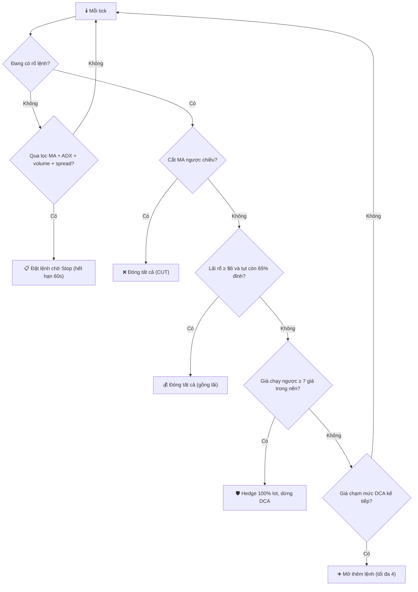

# ⚡ Bot-EA13-Trading-XAUUSD-Scaping

### Gold Grid Stop + DCA EA cho MetaTrader 5

**EA MQL5:** © 2026 Hồ Ngọc Khánh ([@LiinIT](https://github.com/LiinIT)) 
**Phát triển từ:** EA `07_SuperScalping_` (v5.93) cùng tác giả

**Gold Grid Stop DCA EA of Khanh** 
**Donate coffee: 1907.5049.8560.17 (Techcombank) / 68814062001 (Techcombank) !!! Thanks**

---

## 📌 Tóm tắt trong 30 giây

- EA scalping vàng trên khung **M1**: đặt **lệnh chờ Stop** theo hướng của 2 đường MA, khi lệnh đầu khớp thì **DCA thêm tối đa 4 lệnh** cùng chiều trong vùng SL (mỗi 2 giá).
- Cả rổ lệnh dùng chung **SL cách lệnh đầu 15 giá**. Lãi được **gồng theo % đỉnh lãi của cả rổ** thay vì TP cố định.
- Nến chạy mạnh ngược chiều (≥ 7 giá) thì EA **mở lệnh hedge bằng 100% khối lượng rổ** để khóa lỗ, rồi thoát khi tổng 2 rổ có lãi hoặc quá 30 phút.
- ⚠️ **Đây là EA thử nghiệm.** Kết quả backtest 3 tháng của các cấu hình đã thử đều **không có lãi** (xem phần [Kết quả đã đo](#-kết-quả-đã-đo-đọc-trước-khi-dùng)).

| File | Mô tả |
|---|---|
| [`mt5/13_SuperScalping_DCA_v6.11.mq5`](mt5/13_SuperScalping_DCA_v6.11.mq5) | **Bản 1 (v6.11)** - bản gốc |
| [`mt5/13_SuperScalping_DCA_v6.12.mq5`](mt5/13_SuperScalping_DCA_v6.12.mq5) | v6.12 - chỉ vào lệnh khi giá cách EMA nhanh ≤ 4 giá |
| [`mt5/13_SuperScalping_DCA_v6.13.mq5`](mt5/13_SuperScalping_DCA_v6.13.mq5) | v6.13 - 1 lệnh Stop, DCA mỗi 1.0 giá |
| [`mt5/13_SuperScalping_DCA_v6.14.mq5`](mt5/13_SuperScalping_DCA_v6.14.mq5) | v6.14 - lot DCA theo danh sách 0.02→0.03→0.05→0.07 |
| [`mt5/13_SuperScalping_DCA_v6.15.mq5`](mt5/13_SuperScalping_DCA_v6.15.mq5) | **Bản 2 (v6.15)** - thêm dừng bot khi lỗ trong ngày |
| [`mt5/13_SuperScalping_DCA_v6.16.mq5`](mt5/13_SuperScalping_DCA_v6.16.mq5) | **v6.16** - DCA theo khoảng cách liền kề `InpDCAGaps=4,8` (tích lũy 4 và 12 giá), lot `0.03,0.05` (mới nhất) |

---

## 🧭 Dùng ở đâu, với điều kiện gì

| Điều kiện | Yêu cầu | Ghi chú |
|---|---|---|
| Nền tảng | **MetaTrader 5** | Không chạy trên MT4 |
| Loại tài khoản | **Hedging** (bắt buộc) | EA giữ nhiều lệnh cùng chiều và mở lệnh hedge ngược chiều |
| Symbol | **XAUUSDm** (mặc định) | Đổi `InpTradeSymbol` nếu broker dùng tên khác (`XAUUSD`, `XAUUSDc`) |
| Khung chart | Bất kỳ | EA tự đọc M1 (MA, volume), M5 (ADX) |
| Thời gian chạy | Bật **Algo Trading**, nên dùng **VPS** | Lệnh chờ hết hạn sau 60 giây, hedge/gồng lãi cần EA đang chạy |
| Vốn | Xem bảng bên dưới | Lô mặc định 0.01, trần rổ 0.05 lot |

### Lỗ khi cả rổ dính SL (lot 0.01 mỗi lệnh, SL chung cách lệnh đầu 15 giá, 1 giá = $1 / 0.01 lot)

| Số lệnh trong rổ | Khoảng cách tới SL của từng lệnh | Tổng lỗ |
|---|---|---|
| 1 | 15 | **$15** |
| 2 | 15 + 13 | $28 |
| 3 | 15 + 13 + 11 | $39 |
| 4 | 15 + 13 + 11 + 9 | $48 |
| 5 (đầy rổ) | 15 + 13 + 11 + 9 + 7 | **$55** |

👉 Lỗ tối đa **$55** cho 0.05 lot. Để rủi ro dưới 5%/rổ cần vốn **khoảng $1,100**. Vốn nhỏ hơn thì nên dùng **tài khoản cent** hoặc giảm `InpLotSize`.

---

## ⚙️ Cách EA hoạt động

### 1. Vào lệnh đầu (Grid Stop)

| Bộ lọc | Điều kiện (mặc định) |
|---|---|
| **Xu hướng** | EMA 20 trên/dưới EMA 50 (M1), MA nhanh dốc cùng chiều 3 nến, giá đúng phía MA nhanh |
| **Sideway** | ADX(14) trên M5 phải **≥ 20**, nếu thấp hơn thì đứng ngoài |
| **Volume** | Bỏ qua khi volume nến M1 ≥ 2× trung bình 20 nến (spike) |
| **Spread** | ≤ 1.5 giá |
| **Lệnh chờ** | Buy/Sell Stop cách giá 0.5, tự hủy sau 60 giây nếu chưa khớp |

### 2. Quản lý rổ lệnh

| Cơ chế | Cách hoạt động |
|---|---|
| **DCA** | Giá đi ngược lệnh đầu mỗi **2 giá** thì mở thêm 1 lệnh market, tối đa **4 lệnh thêm**, cùng lot (×1.0), trần rổ **0.05 lot** |
| **SL chung** | Lệnh đầu ∓ **15 giá**, gán cho mọi lệnh trong rổ |
| **Gồng lãi theo rổ** | Khi lãi cả rổ ≥ **$6**, đóng tất cả nếu lãi tụt xuống còn **65% đỉnh** (giữ 65%, nhường 35%) |
| **Hedge** | Giá chạy ngược ≥ **7 giá** trong nến M1: mở lệnh ngược chiều **bằng tổng lot rổ**. Thoát khi tổng 2 rổ ≥ **+$10**, hoặc quá **30 phút**, hoặc rổ chính chạm SL |
| **Đảo chiều (CUT)** | MA nhanh cắt ngược chiều rổ trong **2 nến M1 đóng liên tiếp** thì đóng tất cả |
| **BE / Rolling SL** | Có sẵn nhưng **tắt** theo mặc định |

---

## 💰 Kết quả đã đo (đọc trước khi dùng)

> ⚠️ **Tác giả đã backtest và KHÔNG tìm thấy lợi thế bền vững** ở các cấu hình thử. Đừng dùng tiền thật.

**Thiết lập:** XAUUSDm, M1, Every tick based on real ticks, **2026.07.01 → 2026.10.04**, vốn $10,000, lot 0.01, không trễ lệnh, spread thật của broker.

| Cấu hình đã thử | Lãi ròng | Profit factor | Số lệnh | Tỷ lệ thắng | Drawdown |
|---|---|---|---|---|---|
| Runner 1 lệnh, không DCA, SL 5 | **−$708** | 0.93 | 3,298 | 37.8% | $857 (8.5%) |
| DCA 2 tầng, SL 8 | **−$2,135** | 0.90 | 11,068 | 53.2% | $2,529 (24.8%) |
| DCA 4 tầng + hedge + BE/rolling + CUT (bản cũ) | **−$2,245** | 0.93 | 15,902 | 55.5% | $2,810 (27.6%) |

### Điều rút ra
- **Kỳ vọng mỗi lệnh khoảng −$0.14 đến −$0.21**, gần bằng **spread vàng (~$0.26)**: chiến lược gần hòa vốn trước chi phí và spread ăn hết.
- DCA chỉ **đổi hình dạng kết quả** (thắng nhỏ nhiều, thua lớn ít) chứ không tạo ra lợi thế. Cần tỷ lệ thắng > 73% mới hòa vốn khi lỗ đầy rổ $55 so với chốt $20.
- Một khoảng ngắn **5 ngày** có thể cho **+$160**: đó là may mắn của một tuần, không đại diện.
- **Độ trễ lệnh** ảnh hưởng rất lớn (cùng cấu hình +$160 khi không trễ, +$42 khi trễ ngẫu nhiên) vì mỗi lệnh chỉ lãi vài đô.
- Cấu hình **mặc định hiện tại (v6.15)** là tổng hợp các cải tiến sau các backtest trên và **chưa có backtest 3 tháng riêng**.

### Tự đo bằng Strategy Tester
1. **Ctrl+R** → chọn `13_SuperScalping_DCA` → XAUUSDm → M1.
2. Modelling: **Every tick based on real ticks**; bật **trễ lệnh ngẫu nhiên** để gần thực tế.
3. Chạy **ít nhất 3–6 tháng**, nhớ **Reset Inputs** (tester hay giữ input cũ).
4. Dùng vốn lớn (≥ $5,000) khi test để tài khoản không cạn tiền giữa chừng làm méo kết quả.

---

## 🛠️ Cài đặt

1. MT5 → **File → Open Data Folder → `MQL5/Experts`** → copy `mt5/13_SuperScalping_DCA_v6.16.mq5` vào.
2. **MetaEditor** (F4) → mở file → **Compile** (F7).
3. Kéo EA vào chart **XAUUSDm** của tài khoản **hedging** → bật **Algo Trading**.
4. Kiểm tra tab **Experts** có dòng `GOLD GRID STOP + DCA v6.15` và `BUILD = ...`.
5. **Chạy demo** trước khi dùng bất kỳ khoản tiền thật nào.

> Mỗi lần cập nhật, tác giả nâng version và ghi **CHANGELOG** ở đầu file. Hãy đối chiếu dòng banner trong Experts để chắc chắn đang chạy đúng bản.

## 🎛️ Tham số chính

| Nhóm | Tham số | Mặc định | Ý nghĩa |
|---|---|---|---|
| Symbol | `InpTradeSymbol` / `InpMagicNumber` | XAUUSDm / 999889 | Symbol giao dịch và mã nhận diện lệnh |
| Grid | `InpLotSize` | 0.02 | Lot lệnh đầu |
| Grid | `InpTotalLimitOrders` | 1 | Chỉ đặt 1 lệnh Stop mỗi lần |
| Grid | `InpFirstOrderDistance` / `InpStepDistance` | 0.5 / 0.5 | Khoảng cách lệnh chờ so với giá |
| DCA | `InpUseDCA` | true | Bật DCA |
| DCA | `InpDCAStep` | 1.0 | Bước giá giữa các tầng DCA khi lệnh đầu âm |
| DCA | `InpDCALots` | 0.03,0.05,0.07 | Lot từng tầng DCA (số tầng = số phần tử) → chuỗi 0.02→0.03→0.05→0.07 |
| DCA | `InpMaxBasketLot` | 0.17 | Trần tổng lot của rổ |
| Lọc | `InpMaxDistanceFromMA` | 4.0 | Chỉ vào lệnh khi giá cách EMA nhanh ≤ 4 giá (0 = tắt) |
| An toàn | `InpMaxDailyLossUSD` | 150 | Lỗ trong ngày (giờ server) chạm ngưỡng thì đóng hết và dừng bot đến hết ngày (0 = tắt) |
| SL | `InpInitialSLPrice` | 15.0 | SL chung cách lệnh đầu (giá) |
| Gồng lãi | `InpUseBasketTrail` | true | Bật gồng lãi theo đỉnh lãi của rổ |
| Gồng lãi | `InpBasketTrailStartUSD` / `InpBasketTrailGivebackPct` | 6.0 / 35 | Bắt đầu từ $6, nhường 35% đỉnh |
| Chốt cố định | `InpUseBasketTakeProfit` / `InpBasketProfitUSD` | false / 20 | Chốt cứng theo $ (tắt) |
| Hedge | `InpUseHedge` | true | Bật hedge khi nến chạy ngược mạnh |
| Hedge | `InpHedgeTriggerMove` | 7.0 | Giá chạy ngược bao nhiêu thì hedge |
| Hedge | `InpHedgeExitProfitUSD` / `InpHedgeMaxMinutes` | 10 / 30 | Thoát khi tổng ≥ $10 hoặc quá 30 phút |
| Lọc | `InpUseSidewayFilter` / `InpMinADX` | true / 20 | Tránh thị trường đi ngang |
| Lọc | `InpUseMAFilter` | true | EMA 20/50 trên M1 + dốc 3 nến |
| Lọc | `InpUseVolumeFilter` | true | Bỏ qua nến volume đột biến |
| Lọc | `InpMaxSpread` | 1.5 | Spread tối đa (giá) |
| Thoát | `InpReversalMode` | CUT | MA cắt ngược 2 nến thì đóng tất cả (OFF / CUT / FLIP) |

---

## 🆚 Khác gì bản `07_SuperScalping_` gốc

| Bản 07 (v5.93) | Bản 13 (v6.15) |
|---|---|
| Một lệnh tại một thời điểm, SL riêng từng lệnh | **Rổ lệnh** với SL chung và DCA trong vùng SL |
| SL dời theo BE +3/+4 và rolling 15 nến M1 | Gồng lãi theo **% đỉnh lãi của rổ** (BE/rolling tắt) |
| Không hedge | **Hedge** bằng 100% lot khi nến chạy ngược mạnh, có timeout |
| Lọc 1 MA | **2 MA** (20/50) + dốc, **ADX M5** chống sideway |
| Log nhiều, spam `[SL LOCK]` | Log gọn, có version và BUILD |

---

## ⚠️ Cảnh báo rủi ro

- Dự án **phi thương mại, phục vụ học tập**. Không phải lời khuyên đầu tư.
- **Kết quả backtest của chính tác giả là âm** (xem bảng trên). Giao dịch vàng đòn bẩy cao có thể mất toàn bộ vốn.
- Lệnh Stop và hedge có thể **trượt giá mạnh** lúc ra tin (NFP, CPI, FOMC). Nên tắt EA quanh các thời điểm này.
- Rổ đầy lệnh có thể lỗ **$55 cho 0.05 lot** chỉ trong vài phút. Hãy tự tính theo vốn của bạn.
- Luôn chạy **demo** trước và tự kiểm tra bằng Strategy Tester.

---

## ☕ Ủng hộ tác giả

**Gold Grid Stop DCA EA of Khanh** 
**Donate coffee: 1907.5049.8560.17 (Techcombank) / 68814062001 (Techcombank) !!! Thanks**

Donate là **tự nguyện**.

**EA MQL5:** © 2026 Hồ Ngọc Khánh (LiinIT)

